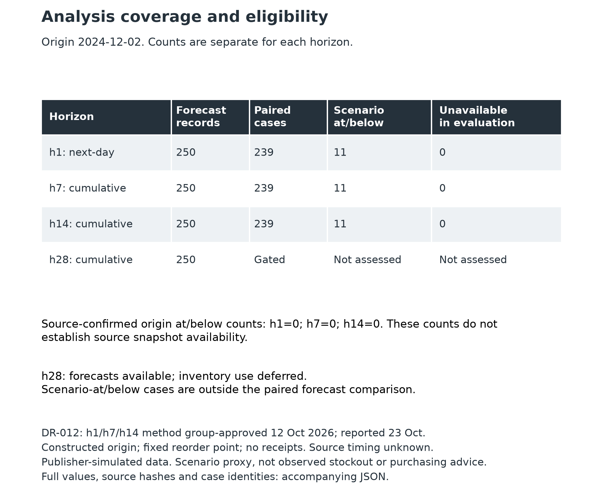
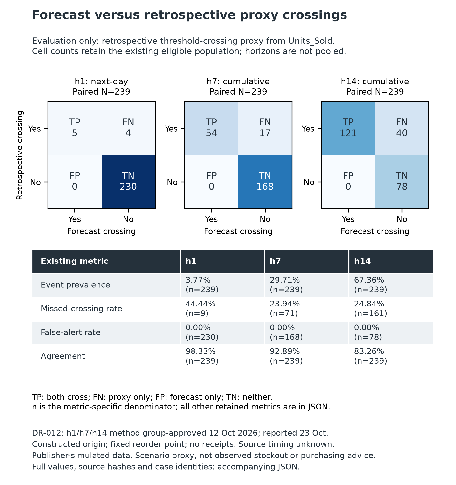
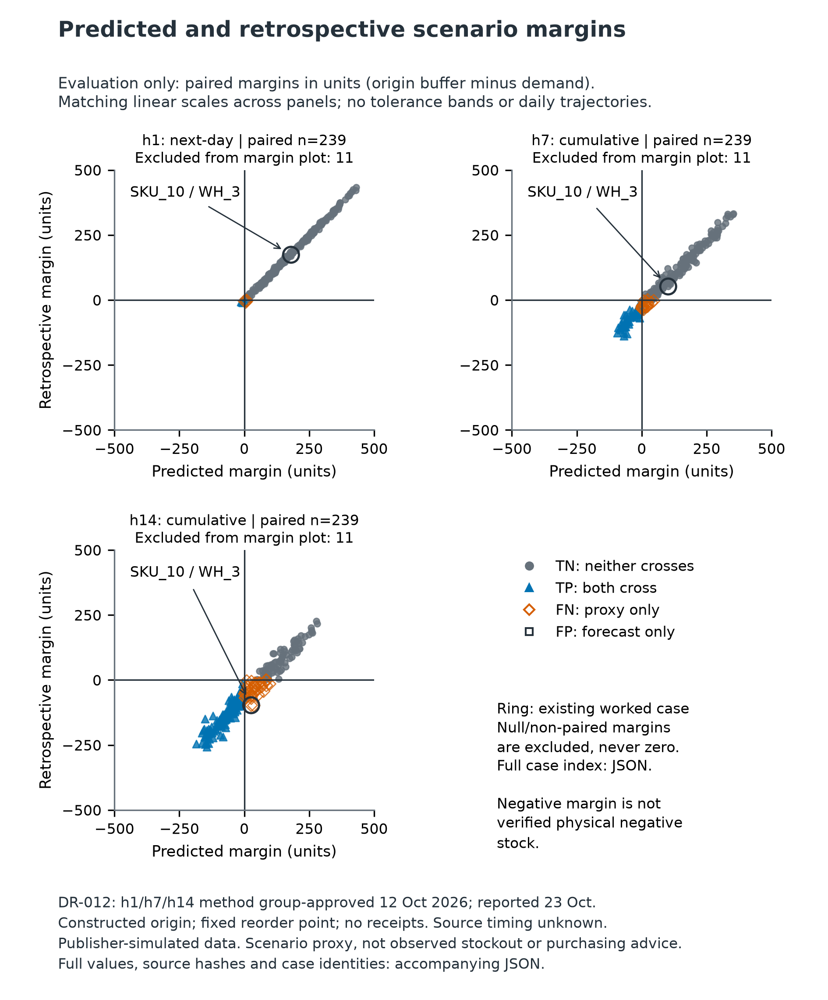
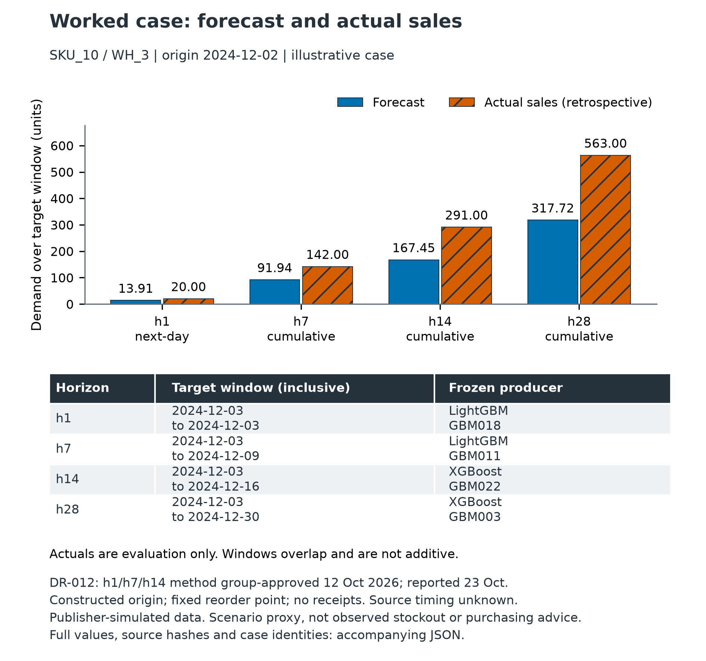
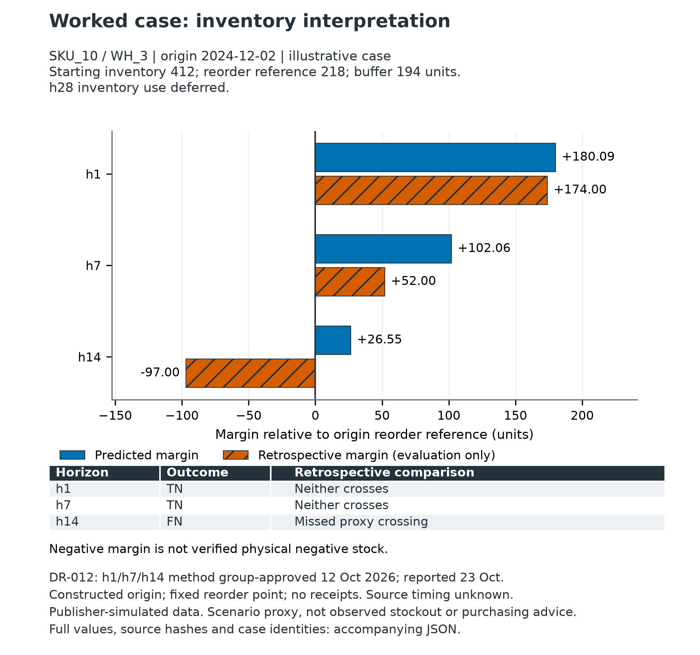
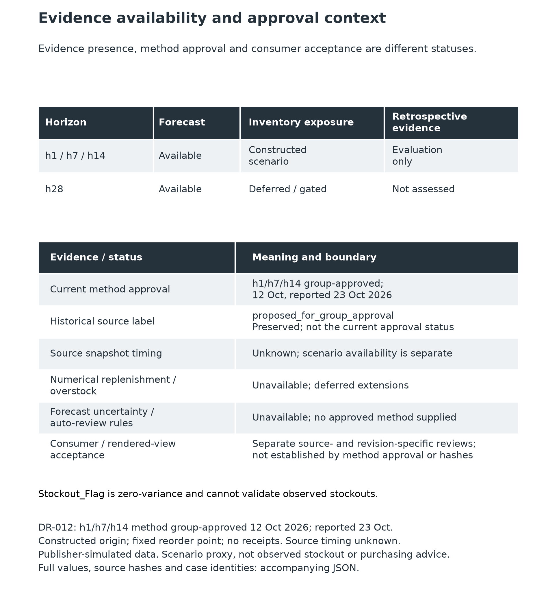
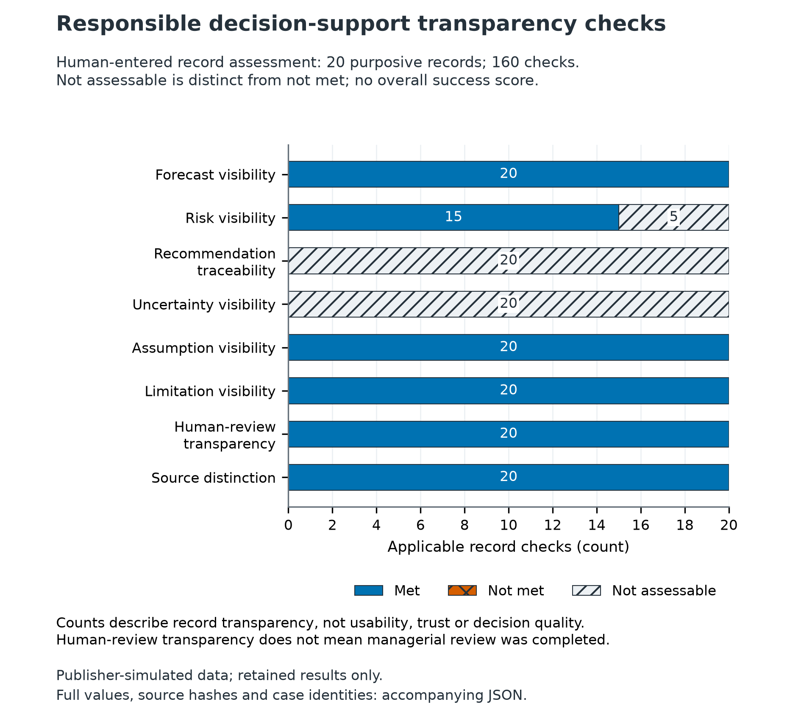
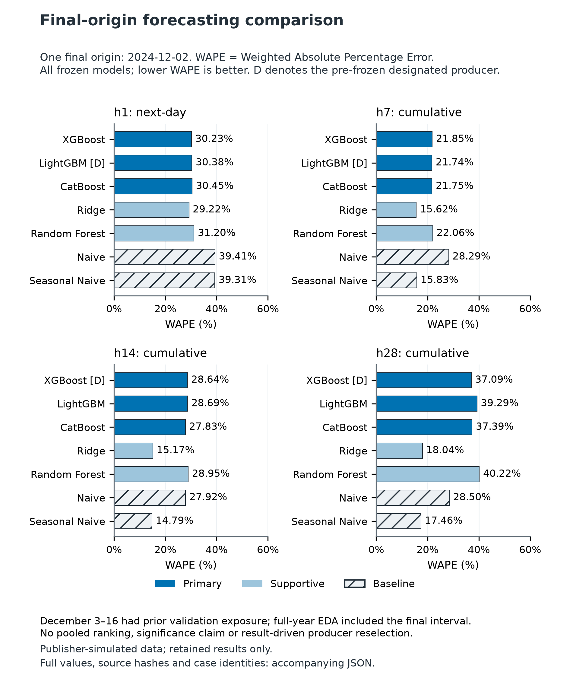

# Thesis / presentation figures

Human visual and component review remains required.

## Analysis coverage and eligibility

Identify the forecast and paired evaluation populations separately.

Coverage at the retained origin. Scenario-at/below cases are outside the paired comparison; h28 forecasts have no inventory evaluation.

[Vector](fig01_coverage_eligibility.svg) | [Full evidence](fig01_coverage_eligibility.json)

## Forecast versus retrospective proxy crossings

Explain crossing detections, missed events and denominator-defined rates.

Retained confusion counts and rates, separately by horizon. High agreement can coexist with missed proxy events; these are not observed stockouts.

[Vector](fig02_proxy_crossings.svg) | [Full evidence](fig02_proxy_crossings.json)

## Predicted and retrospective scenario margins

Locate retained paired margins relative to the zero reorder reference.

Each mark is one eligible SKU-warehouse case, with identity in the accompanying case index. Zero is the reorder reference, not a physical-stock boundary.

[Vector](fig03_population_margins.svg) | [Full evidence](fig03_population_margins.json)

## Worked case: forecast and actual sales

Explain retained demand outputs and underprediction for the existing illustrative case.

One illustrative, purposively sourced pair; not representative. Actual sales are retrospective. Overlapping cumulative windows are not additive.

[Vector](fig04_worked_forecast.svg) | [Full evidence](fig04_worked_forecast.json)

## Worked case: inventory interpretation

Explain how the h14 forecast misses a retained scenario proxy crossing.

Predicted and retrospective margins for the same illustrative case. Negative margin is arithmetic scenario exposure, not observed stockout or physical negative inventory.

[Vector](fig05_worked_margins.svg) | [Full evidence](fig05_worked_margins.json)

## Evidence availability and approval context

Distinguish evidence presence, method approval, unknown timing and deferred methods.

Method approval does not establish source timing, consumer acceptance or operating benefit. Historical proposed labels are preserved as source metadata.

[Vector](fig06_evidence_status.svg) | [Full evidence](fig06_evidence_status.json)

## Responsible decision-support transparency checks

Show existing human-entered criterion outcomes and unassessable methods.

Twenty purposively selected records, eight checks each. Not assessable is distinct from not met; record transparency is not usability or decision quality.

[Vector](fig07_transparency_checks.svg) | [Full evidence](fig07_transparency_checks.json)

## Final-origin forecasting comparison

Compare every frozen primary, supportive and baseline candidate by horizon.

Retained final-origin WAPE; lower is better. All seven models are included. Designation was frozen before final results and is not a final-performance ranking.

[Vector](fig08_forecasting_comparison.svg) | [Full evidence](fig08_forecasting_comparison.json)
